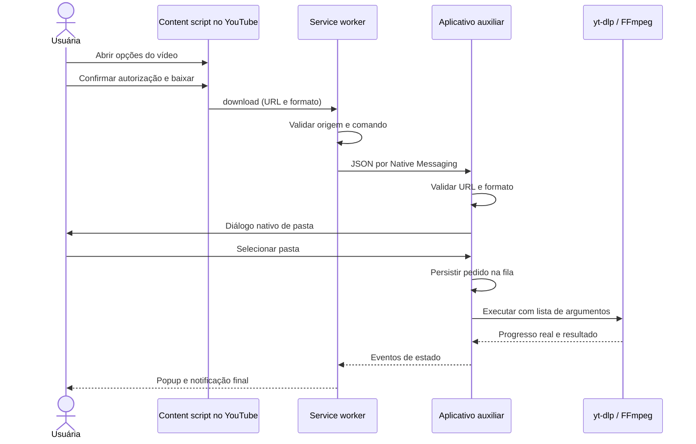

# Arquitetura e compatibilidade

Investigação realizada em 6 de novembro de 2026.

## Escolha: Native Messaging

A [documentação oficial do Opera](https://help.opera.com/en/extensions/message-passing/) documenta `nativeMessaging`, `runtime.connectNative`, comunicação por stdin/stdout e o registro Windows sob `SOFTWARE\Google\Chrome\NativeMessagingHosts`. Portanto, a implementação prioriza Native Messaging. Não é necessário abrir porta localhost, criar servidor HTTP ou distribuir token de autenticação para páginas web.

O host se chama `com.opera_music_downloader`. Seu manifesto permite apenas a origem da extensão com identidade fixa `kinpjcjipphcbboncbjmodfiiblgfaoo`. A chave pública em `manifest.json` estabiliza o ID quando a extensão é carregada sem compactação. Essa chave não é um segredo nem uma assinatura comercial.

A [documentação Chromium atual](https://developer.chrome.com/docs/extensions/develop/concepts/native-messaging) explica registro por usuário, framing e limites. O [ciclo de vida do service worker](https://developer.chrome.com/docs/extensions/develop/concepts/service-workers/lifecycle) documenta que `connectNative` mantém o worker ativo; em falhas, o estado persistido permite informar a interrupção. A implementação mantém uma conexão para a fila, independentemente da duração do popup.

Isso confirma compatibilidade de API documentada; não substitui teste executado numa versão específica do Opera GX para Windows. Veja [TESTES.md](TESTES.md).

## Fluxo

## Fronteiras de confiança

- Sem `externally_connectable`, `eval`, script remoto ou execução de comandos recebidos como texto.
- URLs são normalizadas para vídeos individuais do YouTube. URLs de outros sites, credenciais na URL, playlists como unidade de download e entradas locais não são aceitas pelo protocolo de produção.
- A página não envia caminhos de arquivos. A seleção ocorre no auxiliar e os comandos de preferências ficam restritos às páginas da própria extensão.
- O host usa argumentos separados e `shell=False`. yt-dlp ignora configurações externas; não recebe cookies ou credenciais.
- Os binários de processamento vêm de fontes identificadas no lock de dependências do build e são conferidos antes do empacotamento.
- stdout é reservado ao protocolo Native Messaging; diagnósticos usam stderr. No Windows, stdin e stdout operam em modo binário.
- As preferências e o histórico ficam apenas no computador. Consultas à plataforma e aos seus servidores de mídia são necessárias ao download; não há servidor próprio de coleta ou conversão.

## Dependências e geração do instalador

O [yt-dlp](https://github.com/yt-dlp/yt-dlp) faz extração e download. FFmpeg/FFprobe convertem, mesclam e inspecionam os arquivos. Distribuições oficiais de yt-dlp incluem os componentes EJS; o [runtime JavaScript recomendado](https://github.com/yt-dlp/yt-dlp/wiki/EJS) é preparado junto às demais ferramentas. O projeto não ativa obtenção dinâmica de componentes externos.

O host Python é empacotado no Windows. O [PyInstaller não é um compilador cruzado](https://pyinstaller.org/en/stable/): executar seu build no Linux não produz um aplicativo Windows. Por isso são fornecidos o build Windows e o workflow para gerar o executável, com a ausência do binário explicitada nesta entrega.
